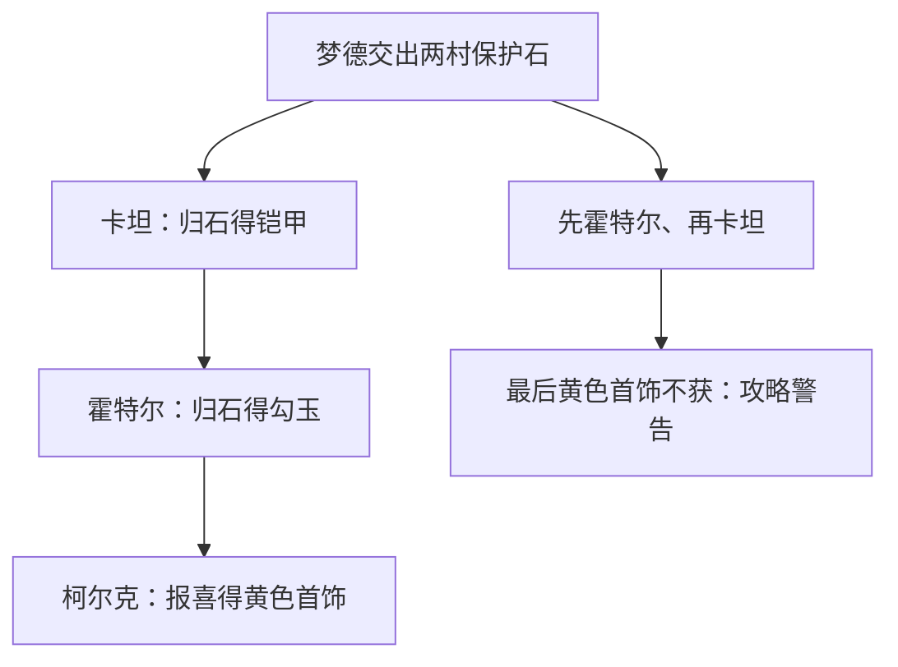

# 梦德洞窟：三村守护石、暗号与领奖顺序来源 R1

任务OFFICIAL-VERSION-NAMED-CONTENT-MATERIAL-REVIEW-81，恢复大陆早期具名任务的文献关系、地图与NPC定位、两件可见奖品说明；不构造原服脚本或开始新作实现。

## 来源和停止边界

S1 [新浪任务攻略](https://games.sina.com.cn/zhqu/sta/rwgl1_11.shtml)，可见题名《石器时代》任务攻略—梦德洞窟，新浪游戏、网友投稿，标2003-05-29 17:00，原作者未具名。当前HTTP200无跳转，50035B/SHA25685b08eec3a4235de8e9a19f8e88abd4698573a74e2c96afb8667fcc4a8208d8b，严格GB18030零替换。门户标题“新石器时代”与2006页脚不认证精确版本、首刊、1.82/台湾1.0归属或官方作者；未取同期认证快照。

正文独立业务区可见1683字符/4783UTF8B/SHA256247b07e0ea2ce1fc925e24cad336b0ab02b2e5a95f9cc6e40f6b38ef50b083bc，独立去标签/实体解码逐字核对。攻略事实均是资料中的主张，非原服运行观察。只一正文、两张实际全图，另十张不扩取。

## 地点、人物和叙事

| 地点 | 大地图位置（攻略） | 互动位置（局部） | 关系 |
|---|---|---|---|
| 柯尔克村 | 43,49；通路318,428 | 红战斗装村姑96,75 | 指引访问两村朋友，最终报喜 |
| 霍特尔村 | 622,193 | 绿战斗装村姑64,65 | 报守护石失窃，收回本村石头赠勾玉 |
| 卡坦村 | 259,170 | 年轻人71,76 | 报祭典受阻、告知洞窟暗号，收石赠铠 |
| 梦德洞窟入口 | 443,127，霍特尔山西水井 | 未名守门盗贼坐标未写 | 输入“在卡坦有梦德”入洞 |
| 洞窟最底层 | 数字楼层未写 | 唐23,42；悟22,42 | 击败二人后见梦德族长，取两村保护石 |

不同位置字段不混命名空间；两名村姑是不同地点的文献出现，不以相同称谓合为同原NPC。梦德族长位置、具体敌方参数/宠物阵容均未知。第一处暗号双引号与第二处不配对「…"原样保留，不当服务器标点/大小写/编码匹配规则。

资料叙事：两村间荒漠是梦德一族盗贼地盘；霍特尔担心失石带来不祥，卡坦因失石无法举行重要祭典；击败唐悟后族长交石。这是世界任务因果关系，不是考古历史或已证明开发者意图。偷物警告不提供目标物类、机率、抗性或事件算法。

## 流程、奖励与反序后果

建议60级是建议，不设为硬等级门；解过成人仪式是原文特殊要求，步行/骑宠和两村精灵羽毛分别保留。不得从推荐、交通与前置推原服flag或等级比较代码。

| 攻略顺序 | 交付/报告 | 奖励口径 |
|---|---|---|
| 1 卡坦年轻人 | 卡坦守护石 | 芙蕾雅Lv1铠6，防+20敏-6，滋润的精灵Lv1 |
| 2 霍特尔村姑 | 霍特尔守护石 | 勾玉；称可换2000S，非直接给2000现金，未述卖店/真实售出 |
| 3 柯尔克村姑 | 两村成功后报喜 | 黄色大首饰，魅+5、睡眠耐性+30 |

原文特别警告先霍特尔再卡坦会失去最后黄色首饰；机器合同保存这条条件，不编造执行flag、回滚/原子事务、其它排列/重做规则。首领取石称“霍特尔的保护石”“卡坦的保护石”，后文以村名守护石称呼，分对象记录，不自动合为一个原物品ID。装备尾字6保留名称，不当已验证装备等级；睡眠耐性+30不解释为30%免疫。

## 两张实际全图

正文12对全图/缩略图，选最后一组第1/3张全图，HTTP链接仅升级HTTPS传输，无主机改写或跳转。

- I1 92532B/SHA2569489d96399a014a090b3265e00af75e2241a96c20e98af75922c3319bc889948。
- I2 94389B/SHA256c5196cae526922f517fe5e146c068e0e23b389b6fe4581d926660f3bab59a5e6。

两图均HTTP200，JPEG/RGB640×480单帧完整Pillow解码/目视。I1沙漠仙人掌和两人物旁开物品窗，铠甲说明显示正文防敏与精灵标签；I2草地石墙旁显示黄色首饰及魅力/睡眠耐性。静态背包不证实刚发奖、属性效果、真实NPC身份或存档；金币/其它物品未逐个抄录。当前像素、文件名时刻和正文发布时刻不认证同期原像素/精确build、原SPR/模型或原生分辨率。

## 既有来源比较与目录

2001运营站记录点表“柯尔克通路附近”与本攻略“柯尔克村存盘”不是同一原位置证明；表中材料名不能被贝洛恩肉替换，缺村名不证游戏无记录点。本攻略只有路线建议，不补用肉数量/消费、原存储格式或重开savedata。2003五兄弟指南的吉鲁岛贝洛恩生态不当本洞窟出生；转生重做/奖励重选和同名精灵不转作本任务规则/同ID。

17完整文献行=1任务、7 NPC出现、1地图路线关系、5物品、1路线教程、2静态屏幕。七必填字段及19集合逐核；原ID为空、研究权利非生产许可，不宣称17原实体复原。SOURCE固定三父报告/共享解析器原字节与原生Git身份。

验证：本包7单元/相关24项本地通过，一文两图离线回放、27去正文指纹门语义改写、隐藏/正文外2反例和外围script正例通过。首次相关回归调用了不存在的five_brothers测试模块名，修正为现有test_stoneage_five_brothers_source后全过，源测试和回放本身通过；不改写失败记录。网页读取器曾报Unicode decoding error，当前原HTTP取得/严格解码成功，非来源缺失。远端候选/main及ZIP保管须实际后验。

停止于一攻略两奖品屏幕。重开需同版商业脚本/flag/原ID、认证历史原图或实际通信/存档。下一最高NEXT82回台湾地区具名宠物模型/技能/生态或官方版本世界线材料；不继续扩梦德盗物/通用脚本辅助。Stage A7 PARTIAL+2 OPEN，B/wiki GATED，savedata R79 PAUSED_NON_BLOCKING；无整体百分比。

### R81双端取源验收与永久派生保管（2026-10-23）

内容2530499c76c3780e8b7d2e15982563d88f93f0c5/treed112a01ed9f932df14745e94792acf92f412f29c，候选10/main11项实际completed/success，九文件原生Git blob及整tree逐一相符，四连续性旧全文前缀完整；新读main旧HEAD后expected_sha保护非强制快进。专用候选run39874364409/job120156231594/artifact12466888933，主线run39874471682/job120156583328/artifact12467880934，实际各7单元及一正文两完整JPEG实取解码、27去正文指纹门语义改写、隐藏/正文外2反例成功。

两实际ZIP各5170B，SHA25686f190d3e823f3c69ab6bc823a7256b4bace790c8b6061ac981c4eb51f225ef7 / 8922bd5b4b1067e48a207800bab5b30f3fa4c28d58b9bdbed9055d68e85ce93f分别符合API；唯一replay.json各32210B/SHA25643a01c1bcce470814879c163a7b1d135874b5777aa218c2a92063263a64861cb。候选/main/local/保管门后local四份逐字节相同，三HTTP输入均同初取；这不是2003原字节/原像素认证或原服事件运行。

双原CI JSON与STONEAGE-CN2003-MENGDE-CAVE-CUSTODY-R1.json永久入Git；七pin固定SOURCE、三父报告、共享解析器和双原报告原字节/Git身份。收据保存内容HEAD/tree、21实际run、双job/artifact/ZIP/raw/input历史。CLI强制验保管并固定完整21项run摘要及源run/job/artifact准确ID，拒绝缺失/同长篡改、错HEAD/tree/分支/任务、遗漏/重复或成功门替代、复用工件、虚报初取相等或提升官方作者/历史字节/原服权威。新增第8保管单元，相关25项本地回归通过，原输出字节不变；原内容CI七单元历史不改称八单元。保管提交自身候选/main须另实后验。

本包可查的是三村叙事、文献NPC出现/分层坐标、口令、取石和顺序敏感奖励，未取得原任务脚本/flag、模型或盗物算法。领奖次序与原字串、2000S可售非现金、推荐非硬门、画面非实发奖及早期记录点/吉鲁生态边界不变。最高NEXT82转台湾具名宠物模型/技能/生态或官方版本世界线；Stage A7 PARTIAL+2 OPEN，B/wiki GATED，savedata R79 PAUSED_NON_BLOCKING，旧历史全留。

## 文献中的领奖分支

以下只呈现攻略的顺序警告，不模拟商业服事件flag；反序分支没有据此补其它奖励/消费状态。

