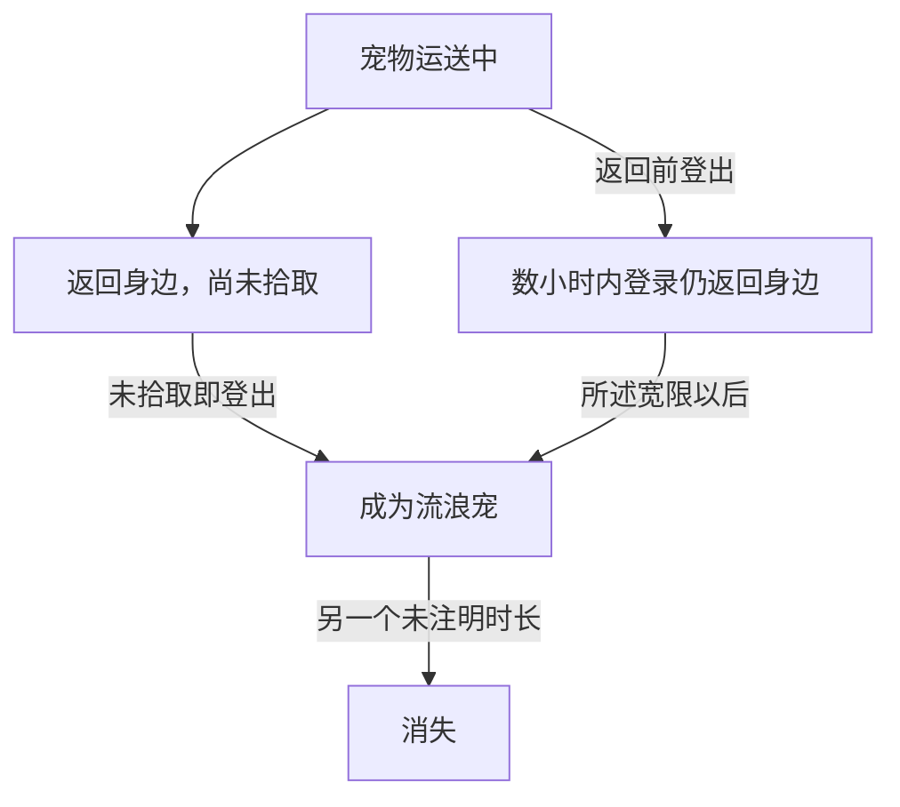

# JSS2001物品、宠物邮件与共用场所：九节早期一方行为合同 R1

2026-10-19（Asia/Shanghai）。R8覆盖复审回到早期关键交互，限定手册九节，不增加网页/图片/程序，不扩savedata辅助链。

## 来源与真实增量

原JSS官网 `http://www.titan.co.jp/stoneage/manual02.html` 的实际保存为20010418083149id_；本轮重新取得28434字节，SHA256 `50b9771ec501067136629c8e083a190e979e53dd9ba141903f78b76d43b602cc` 与此前原件完全一致，Shift-JIS严格解码。

**不是新发现网页，也不是首次给全篇指纹。** 旧通用目录JSS-LOGIN-MANUAL-CREATION-CONTRACT-R1已列3070/7010/8030的关键词和段落摘要，manual02的creation_contract为null；另两份已有内容合同覆盖12节宠物/战斗/合成及6节普通落地/服务/公车。本次九节与那18节无重叠，增量是七组物品/邮件/社交操作语义和两个场所描述，含精确例外与未知字段。旧指纹和旧成果保留，不重复计新源。

## 九节实际补上的内容

| 节号 | 来源支持的说明 | 必须保留的边界 |
|---|---|---|
| 3060 | 双击用物；视物品才出现目标窗；装备可拖放或双击；调金额后放地 | 不推所有物品都选目标；不造背包/堆叠容量、钱的校验或交易协议 |
| 3070 | 名片登记联系人；普通邮件与宠物载信/载物；返还/登出/流浪消失分支；战斗可普通收发，不能宠物收发 | 数小时宽限与流浪消失是不同未知计时，不造秒数、原保存格式或自动消灭 |
| 7000 | 拾取和商店购买进入物品栏 | 不得到物品ID、容量或原服持久写入 |
| 7010 | 说明双击后从组窗左击角色名字选目标的流程 | 与3060条件合读，不把一种流程强加所有物品 |
| 7020 | 邻接地面物品后右击拾取 | 不推坐标范围、归属/锁定标志或实际网络包 |
| 8030 | 允许交换名片、邻接且面对、按钮左击；登记到邮件窗；登出使交换开关回NO；组队中玩家彼此不能换 | 开关复位不是联系人清空；不扩大为所有组队玩家对非队员的全部情况 |
| 8040 | 原说明会话保存在stoneage目录的chatxxxxxx.txt，占位符为日期 | 不是原代码写文件实测；日期格式/编码/路径及服务器/云端归档未知 |
| 8110 | 四出生村可共同进入的免费聊天室，3房间、大厅、婚礼场地，与斗技场相连 | 与斗技场往来的票据警告有语境，不推所有免费聊天室访客先买斗技票 |
| 8120 | 购票入斗技场；等级≤9、DP名次77或777分别列为免票情形；场内医院恢复免费，另有3类商店、4试合场、可观战 | 不把三种免票情形连成同时满足；不把场内免费医院扩大到全世界医院；票价/其他未提例外/DP公式未知 |

四出生村原名按源为サムギル、マリナス、ジャジャ、カルターナ。这里只证明手册说它们有共用入口，不给原map ID、路线边或跨地区同构建对应；四试合场也不是四张已恢复地图。九条分别存tutorials七条、maps两条，均有既有七必需字段、节号、段落摘要和逐条出处。

## 宠物邮件生命周期

图示只是手册描述。数小时未给具体值，宽限从哪个服务端时间字段计起、离线如何调度、捡回后状态和背包/宠物栏事务均未证。战斗普通邮件可用不等于宠物送物可用。没有因为文本提登出就重开R79，或声称原服实际IO已执行。

## 特殊票据与场所语境

8110和8120都写票丢地即消失，可能无法离场，登出从SP重开。分别留在各节出处下，不补两个票同物品ID、不说登录恢复票，也不把特殊票立即消失套到普通落地物品。普通落地物品的未知延时消失已经是7030旧成果，不能与票或宠物宽限合成一个TTL。

2003 Hangame只列聊天室入口、另有收费/等级条件的问答场；它没有把聊天室费用、斗技场免票和共同地图完整列出。2005 Wayi剧场/两游乐场是艺术值/积分兑换的另一组源。当前不能把三组相似“场所”名称合并、把2001斗技票规则移给2003问答场，或倒填2005积分/奖品到2001斗技场。相邻有限衔接包将只复用既有报告解决这些来源关系，零新增网络源、零游戏实现。

## 验证、保管与下一步

12项反例覆盖普通/宠物邮件、计时未知、开关/联系人、物品条件目标、免费例外、局部免费医院、票据身份/恢复、源资格及归档。相关31项本地回归通过。独立工作流仅重取同一已知精确手册，对九节长度/SHA和业务词/数值校验，完整派生报告cmp；实际源run/HEAD/job、ZIP/raw/Git与main验收另行据实保管。原文、图像与客户端/服务器均不入Git，不启动新游戏/百科。

NEXT `EARLY-SOURCE-MAIL-VENUE-CROSS-VERSION-BOUNDARY-01`：沿本报告和已有2001普通物品/2003设施/2005场所报告，完成一次有限来源衔接，明确哪个概念可作相似性参考、哪些时间/物品/场所绝不能合并；不新增原网页或资产，不重铺22域。Stage A7 PARTIAL+2 OPEN、Stage B/百科GATED、R79暂停，未证明JSS1999/TW1.0/CN1.82同构建或整体完成率。
